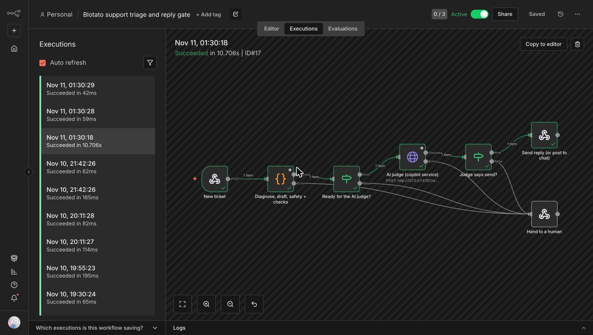

# Blotato Support Copilot

[Blotato](https://www.blotato.com) schedules social media posts from an app, an API, n8n or an AI agent. When a customer writes in that a post failed, this tool finds the likely cause, drafts the reply, and **blocks the reply if it gives a wrong fix**.

- **On 20 fresh tickets written by a separate AI agent that never saw the code:** 19 of 20 diagnosed right on the first run (20 of 20 on the final version), 12 answered automatically, 8 handed to a person, **0 wrong replies sent**. Keyword rules alone got 12 of 20; Claude handles the rest. ([how it was measured](docs/scoring.md))
- **Run against Blotato's live API on 2026-11-10.** It found 3 bugs in this tool (each fixed, with a test) and 2 things customers get stuck on: a cancelled post reads "in-progress" just like a stuck one, and a published post can't be deleted through the API or MCP. ([live test](docs/live-test.md))
- **Every score is yes/no checks you can rerun.** No partial credit. ([how scoring works](docs/scoring.md))

Try it in under 2 minutes, no API key, no network:

```bash
npm install && npm run demo
```



*A real run in n8n: the ticket "my scheduled post went out right away" is diagnosed, the built-in reply passes all 10 gate checks, and it takes the "send" path. The same flow sends refunds, unknown errors and failed drafts to a person ([that run](docs/img/n8n-run-human.jpg)).*

## What it does

| Step | Command | What it answers |
|---|---|---|
| 1 | `doctor` | Is the customer's setup right? Key, connected accounts, Facebook and LinkedIn pages, expired connections. Stops at the first real problem. |
| 2 | `validate` | Is the request right? Checks a `POST /v2/posts` body against Blotato's documented rules before it is sent. |
| 3 | `explain` | What does this error mean? Turns a status code, an error body or the customer's own words into a cause, a fix, "needs a person: yes/no", and a draft reply. |
| 4 | `gate` | Can the reply go out? A safety screen first: self-harm, hacked accounts, legal threats, privacy requests, shared passwords or a request for a person go straight to a person. Then 10 yes/no checks, all 10 required. Nothing is sent on keyword rules alone: with the AI on, Claude diagnoses every ticket independently (it must agree with the rules), and an AI judge that reads the whole message must meet all 10 checks too. Example: "Obviously your key is wrong, read the docs." meets 4 of 10: HOLD. Five hostile reviewer rounds wrote 123 attacks; every one that got through became a test, and all now pass ([how](docs/scoring.md)). |
| 5 | `triage` | The whole ticket: diagnose (rules first, then Claude if no rule matches), draft, decide SEND or a person. |

It ships as a **CLI**, an **MCP server** for Claude Code, Codex or Cursor, a **Claude Code skill** for ticket triage, and two **n8n workflows**.

## The scheduled-post example

| Customer says | What actually happened | Caught by |
|---|---|---|
| "My scheduled post went out right away" | `scheduledTime` was nested inside `post`, where Blotato ignores it | `validate`, `explain` |
| "I get 401 but I copied the key" | The trailing `=` was dropped, or a space, quote or `Bearer ` crept in | `doctor`, `explain` |
| "Facebook post fails" | `target.pageId` missing | `validate`; `doctor` lists the page IDs |
| "TikTok post rejected" | One of the six required booleans or `privacyLevel` missing | `validate` |
| "Media error 90009" | A Google Drive share page or Dropbox `dl=0` link, not the file | `validate` rewrites the Drive URL |
| "Post stuck in-progress" | Wrong `postSubmissionId`, or the schedule was cancelled (both read in-progress, verified live) | `explain`, `status` |
| "Rate limit exceeded" | Polling faster than the limit | the client waits the server's retry time; `explain` |
| "LinkedIn page list errors" | Connection expired (422) | `doctor`, n8n health check |

## Use it with a real key

```bash
npm install && npm run build
export BLOTATO_API_KEY='your key, including any = at the end'

node dist/src/cli.js doctor
node dist/src/cli.js validate examples/broken-scheduled-tweet.json
node dist/src/cli.js explain --status 429 "Rate limit exceeded, retry in 49 seconds"
node dist/src/cli.js status <postSubmissionId>
node dist/src/cli.js gate --status 401 "Obviously your key is wrong, read the docs."   # 4/10 HOLD, lists each check
node dist/src/cli.js triage --ai claude-cli "my post went out 2 min after I hit save"  # rules miss it, Claude picks the issue
```

## MCP: two servers, two jobs

`.mcp.json` registers both:

- **`blotato`** (Blotato's official server, `https://mcp.blotato.com/mcp`) does things: lists accounts, creates posts and visuals, uploads media.
- **`blotato-support-copilot`** (this repo, stdio) supports people: diagnoses, validates, explains, gates replies. `blotato_publish_post` only validates unless the call sets `dryRun: false`, and the triage skill tells the agent never to post for a customer from support.

Tools: `blotato_doctor`, `blotato_validate_post`, `blotato_explain_error`, `blotato_gate_reply`, `blotato_post_status`, `blotato_publish_post`.

```bash
claude mcp add --transport http blotato https://mcp.blotato.com/mcp --header "blotato-api-key: $BLOTATO_API_KEY"
claude mcp add blotato-support-copilot -- node "$(pwd)/dist/src/mcp.js"
```

## n8n

Both flows ran in n8n 1.123 on 2026-11-10.

- **`n8n/support-triage.json`**, a drop-in step for a 24/7 support agent. A webhook takes a ticket (`message`, optional `status`, `errorBody`, `requestBody`, and `draftReply` if your AI agent already wrote one). One Code node holds the copilot, bundled from this repo's source by `npm run build:n8n` (a test fails if the committed flow ever drifts from the source). Only diagnosed issues that don't need a person, with a reply that passes the gate, go to "send". Refunds, unknown errors, failed drafts and any Code node error go to "hand to a human".
- **`n8n/connection-health-check.json`** runs daily or on "Run now": lists accounts, checks each Facebook and LinkedIn connection 2.5 seconds apart, and outputs only the broken ones. Set `BLOTATO_API_KEY` as an n8n environment variable.

```bash
npm run n8n:demo                      # local n8n at http://localhost:5678 with the triage flow active
npm run n8n:ticket -- "My scheduled post went out right away"
npm run n8n:ticket:bad                # an AI draft that blames the customer: HOLD, routed to a person
```

## Where the rules come from

Every rule maps to Blotato's help docs or a live API response. Rules added on 2026-11-09 came from about 72 public sources: n8n and Make forum threads, GitHub issues, Trustpilot reviews and the help docs ([ticket evidence](docs/ticket-evidence.md)). The replay ran 48 real reports through the copilot: 15 diagnosed correctly before tuning and 48 after. That 48 is on the same cases the rules were tuned on, so the honest number is the blind set above.

Help-center drafts from the live findings: [docs/help-articles/](docs/help-articles/).

## Claude Code skill

`.claude/skills/blotato-support/SKILL.md` teaches Claude Code to triage a ticket: sort it, diagnose with the MCP tools instead of guessing, draft the reply, run the gate, and hand off with the key removed.

## Tests

```bash
npm test                          # unit tests, adversarial gate cases, real-ticket replay, n8n drift check
node scripts/check-replies.mjs    # all 30 built-in replies must pass the gate
COPILOT_JUDGE=claude-cli node scripts/judge-eval.mjs   # the AI judge on known-answer drafts (uses Claude)
AI=claude-cli node scripts/blind2.mjs                    # the 20-ticket fresh blind set, end to end (uses Claude)
```

The doctor, retry and round-trip tests use a local mock server, which needs permission to open a local port. CI runs the tests, the reply check and the demo on every push (`.github/workflows/test.yml`). The judge eval uses Claude, so it runs by hand.

## License

MIT
